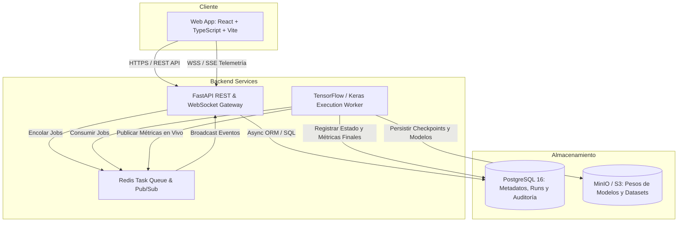

# Arquitectura de Software - NeuroLab Enterprise

## 1. Visión y Metas Técnicas
NeuroLab Enterprise resuelve la brecha entre la experimentación académica de redes neuronales (Semana 11) y el estándar industrial de software. Los requerimientos no funcionales clave son:
- **Resiliencia:** Un fallo o cancelación en un entrenamiento no compromete la API ni el frontend.
- **Trazabilidad:** Cada peso de modelo guardado tiene un hash SHA-256 asociado a su arquitectura y dataset exactos.
- **Seguridad:** Aislamiento de procesos (sandboxing) y RBAC (Role-Based Access Control).

## 2. Diagrama de Capas (C4 Modelo - Nivel 2: Contenedores)

## 3. Decisiones Arquitectónicas (ADRs)

### ADR-01: Desacoplamiento de TensorFlow del API Gateway
- **Contexto:** Entrenar una red neuronal consume ciclos de CPU/GPU intensivos y bloquea el event loop asíncrono si se ejecuta en el proceso web.
- **Decisión:** Toda invocación a `tensorflow` o `keras.fit()` se delega a un proceso `Worker` independiente a través de Redis. La API sólo actúa como despachador y validador de configuración.

### ADR-02: Telemetría Híbrida (Eventos en Tiempo Real + Persistencia SQL)
- **Contexto:** Si un usuario recarga la página o se desconecta temporalmente durante la época 40 de 100, la UI no debe perder el historial.
- **Decisión:** El worker publica cada época en Redis Pub/Sub para difusión inmediata vía WebSocket/SSE a la UI activa, y simultáneamente registra la métrica en la tabla `training_metrics` de PostgreSQL. Al reconectar, el cliente lee de la BD y continúa escuchando el socket.

### ADR-03: Inmutabilidad de Artefactos de Modelos
- **Contexto:** En IA empresarial, sobreescribir un modelo desplegado genera riesgos regulatorios y de reproducibilidad.
- **Decisión:** Toda versión registrada en `model_versions` genera un ID único, almacena su checksum SHA-256 y sus pesos son de solo lectura en Object Storage.
